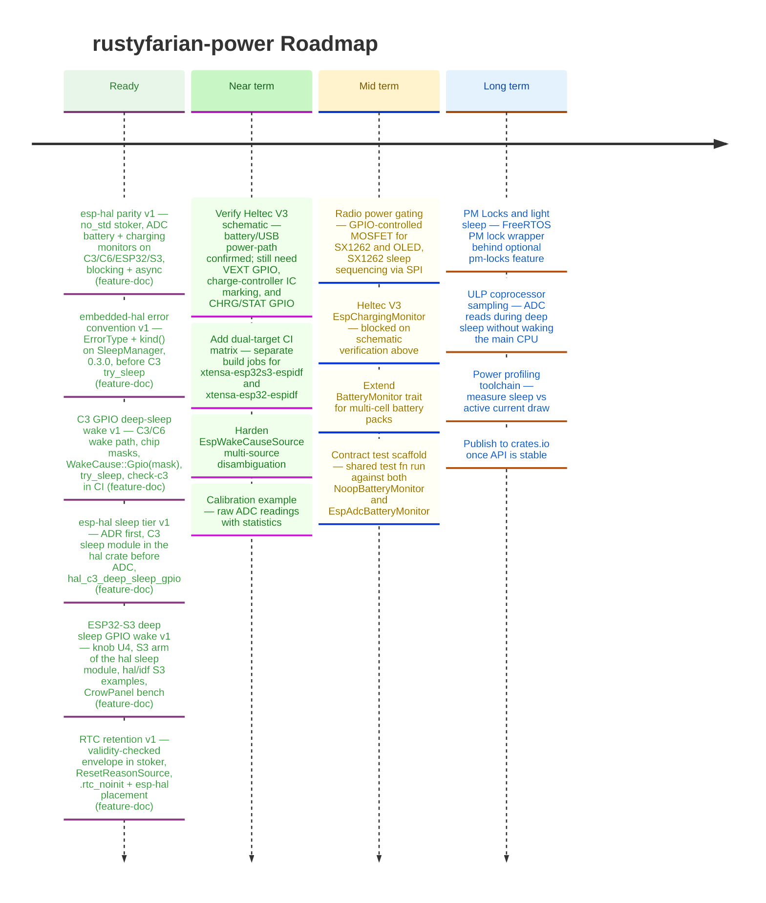

# Roadmap

*Last updated: October 2026*

Charging detection and deep-sleep wake-source handling are working on both Heltec V3 and Adafruit Feather V2.
The Feather V2 has a complete `EspChargingMonitor`; the Heltec V3 charging implementation is blocked on schematic verification of the charge controller IC and its GPIO — an inversion relative to the README's "primary target" framing that near-term work must resolve.
Simultaneous battery + USB operation is confirmed safe and intended on both boards (vendor docs cited in `docs/key-insights.md`); what remains for Heltec is the exact charger-IC marking and a STAT/CHRG status GPIO.
The ESP-IDF tier moved to the September 2026 family stack (`esp-idf-hal 0.47` / `esp-idf-sys 0.38.1`) on 2026-09-26, in step with `rustyfarian-network`, `-ws2812` and `-peripherals`.
Both crates shipped as `0.2.0` on 2026-09-26, so downstream apps can combine power with the siblings in one `esp-idf-sys` graph.
On 2026-10-12 rustbox-spookhouse filed three C3 sleep requests; all three have feature docs and ship together as 0.3.0 after the `stoker` no_std/error-enum step.

