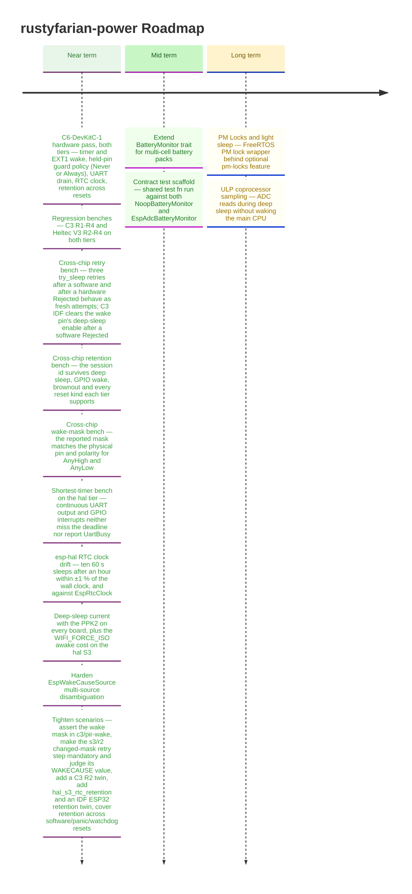

# Roadmap

*Last updated: November 2026*

`stoker` plus the ESP-IDF and esp-hal tiers cover battery monitoring, charging detection, deep-sleep wake sources, RTC retention and clock, and the Vext rail gate on the C3, C6, ESP32 and S3.
Hardware checks are rustyfarian-bench scenarios in `bench/`; the shipped state per release is in `CHANGELOG.md`.
Neither the Feather V2 nor the Heltec V3 exposes a charge-status GPIO on the stock board, so charging detection stays a documented limitation there (`docs/project-lore.md`).
The ESP-IDF tier tracks the family stack of `rustyfarian-network`, `-ws2812` and `-peripherals`, so downstream apps combine the crates in one `esp-idf-sys` graph.

