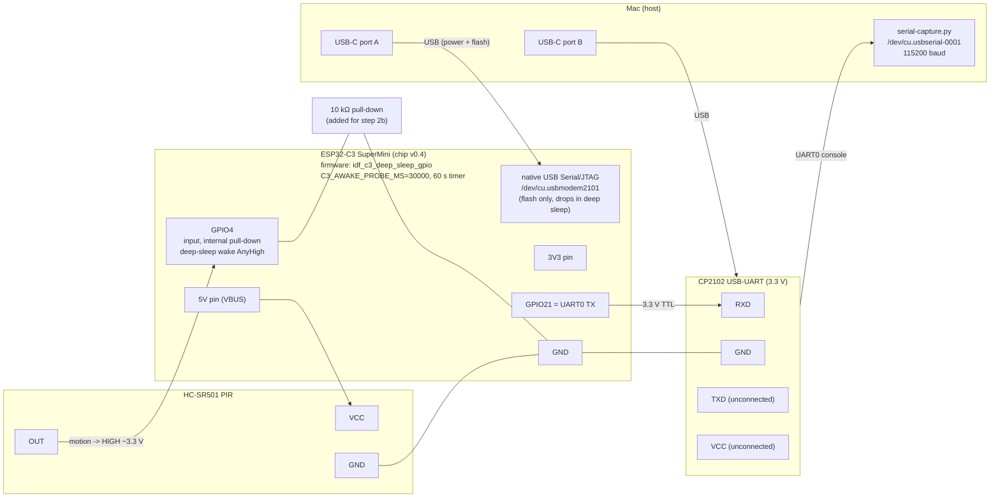

# Bench Steps: ESP32-C3 IDF Tier With a Real PIR v1

Draft, 2026-10-12.
Runbook for the P0 cases of [the bench plan](c3-devkitm1-sleep-bench-plan-v1.md) that an HC-SR501 PIR can drive with the `idf_c3_deep_sleep_gpio` example: W1, W2, H1 and H4.
It needs no stimulus board, logic analyser or PPK2, so it also shows what a real sensor does that the plan's host-driven stimulus does not.

## Setup

Wire the board as described in the example's doc comment (`crates/rustyfarian-esp-idf-power/examples/idf_c3_deep_sleep_gpio.rs`):

| Signal  | Connection                         |
|:--------|:-----------------------------------|
| PIR OUT | GPIO4, with 10 kΩ pull-down to GND |
| PIR VCC | 5V                                 |
| PIR GND | GND                                |

- Meter PIR OUT at 3.3 V before connecting it; the C3 pads are not 5 V tolerant.
- Put the HC-SR501 jumper in "H" (retrigger) mode.
- Set the time-delay pot to its minimum (a few seconds) unless the case says otherwise.
- Let the PIR warm up for about a minute after power-on; it reports spurious motion until then.
- Attach no JTAG probe; GPIO4 is MTMS.

Every boot prints a line in this format, and with `C3_BENCH_LOG=1` at build time so does every `try_sleep` return; `cycle` stays 0 because the host counts boots:

```text
BENCH case=demo tier=idf cycle=0 reset=<reason> cause=<cause> mask=0x<hex> result=<boot|ok|err:Rejected|err:<kind>> guard_us=0 drain_us=0
```

The boot line uses `result=boot`.
With `C3_BENCH_LOG=1` the firmware prints one `err:Rejected` line per rejected attempt (every 50 ms); the compact count every 20 is always printed.
Before the first `try_sleep` it prints `GPIO4 level before sleep: High|Low`, which shows whether H1's precondition held.

Build and flash:

```shell
just build-example idf_c3_deep_sleep_gpio
just run idf_c3_deep_sleep_gpio
```

`just run` flashes and opens the monitor; `just monitor` reattaches to a running board.
Each case starts from a fresh flash and a power-on boot (`cause=PowerOn`), then proceeds as below.

## W1: GPIO4 wake

Build: default (60 s timer).

1. Flash and wait for the first `Sleeping: GPIO4 AnyHigh + 60000 ms timer` line.
2. Keep out of the PIR's view (cover it with a cup) until the first sleep succeeds.
3. Uncover the PIR and wave once.

Expected:

```text
Wake cause: Gpio — fired pins: 0x10, GPIO4 fired: true
BENCH case=demo tier=idf cycle=0 reset=DeepSleep cause=Gpio mask=0x10 result=boot guard_us=0 drain_us=0
```

Pass: the board wakes within a second of the motion, before the 60 s timer, with `cause=Gpio` and `mask=0x10`.
Repeat 10 times by eye.
A real PIR cannot meet the plan's 100 cycles at a controlled 100 ms pulse, nor the 50 ms edge latency, without a logic analyser; only "wakes promptly, right cause and mask" is checkable.

Result: pass on 7 waves (owner accepted 7 instead of 10), 2026-10-12, ESP32-C3-MINI-1 board with a CH340 bridge, firmware `8a1c9b6`, default build.
Uncovered, with motion at the desk: 20 of 20 sleeps entered with GPIO4 Low woke with `cause=Gpio mask=0x10`, after 1.8 to 16 s, before the timer.
Covered run, same day, from a power-on boot: 7 of 7 deliberate waves woke the board with `cause=Gpio mask=0x10` before the timer.
With the PIR quiet afterwards, 4 of 4 wakes were the 60 s timer (`cause=Timer mask=0x0`, slept 59.93 to 60.03 s).
After each wave the held output caused the H1 boot loop (65 entries), then the board slept normally.
Not timed: "within a second of the motion"; the host log has no motion timestamp.

## W2: Timer fallback

Build: 5 s timer (the variable must be set for the build that is flashed).

```shell
C3_SLEEP_TIMER_MS=5000 just run idf_c3_deep_sleep_gpio
```

1. Cover the PIR, or keep still and out of its view, and wait for the sleep line.
2. Watch the boot lines over at least 10 cycles.

Expected: `Sleeping: GPIO4 AnyHigh + 5000 ms timer`, then a boot about every 5 s with `Wake cause: Timer` and `cause=Timer mask=0x0`.

Pass: `cause=Timer` on every wake, at about 5 s.
Timing by eye or from the monitor's host timestamps is good to roughly 0.5 s, so the plan's ± 5 % (250 ms) is not verifiable here.
The boot-to-boot period also includes boot time and the sleep-entry path.

Result: pass, 2026-10-12, firmware `8a1c9b6` built with `C3_SLEEP_TIMER_MS=5000`.
Covered PIR, from a power-on boot: 15 of 15 consecutive wakes reported `cause=Timer mask=0x0`.
They slept 5002 to 5012 ms from the `Sleeping:` line to the ROM `rst:0x5` line, and boot-to-boot was 5.386 to 5.395 s, both by host timestamps.
No rejection, panic or restart appeared.
Earlier uncovered run, same firmware:
24 of 24 timer wakes reported `cause=Timer mask=0x0`, and no timer wake was misreported as GPIO.
Slept 4999 to 5012 ms from the `Sleeping:` line to the ROM `rst:0x5` line, and boot-to-boot was 5.07 to 5.40 s, both by host timestamps.
The other wakes in that run were motion (`cause=Gpio mask=0x10`).

## H1: wake-pin-held-at-entry, PIR retriggering

Build: `C3_BENCH_LOG=1 just run idf_c3_deep_sleep_gpio`.

1. After a W1-style GPIO wake, keep waving at the PIR so it retriggers and its output stays HIGH.
2. Watch the first `try_sleep` after boot.

Expected:

```text
Sleeping: GPIO4 AnyHigh + 60000 ms timer
try_sleep rejected (first): <error text>, kind=Rejected
BENCH case=demo tier=idf cycle=0 reset=DeepSleep cause=Gpio mask=0x10 result=err:Rejected guard_us=0 drain_us=0
```

Pass: the plan accepts either outcome if it repeats; record which one happens.
Here the expected one is `err:Rejected`, and the chip stays awake instead of sleeping and waking at once.
Repeat 10 times; a mix of outcomes is a failure.
This also answers I1 (`kind() == Rejected` from the `esp_deep_sleep_try_to_start` call site) by eye.
The plan's 100 of 100 needs automation and is not reachable by hand.

Result: observed 2026-10-12, firmware `8a1c9b6`, default build (the `try_sleep rejected (first)` line prints without `C3_BENCH_LOG`).
Outcome: no rejection; the chip sleeps and wakes at once, in 248 of 250 entries that read GPIO4 High across both builds.
The other 2 slept 3 s and 5 s; the PIR likely released between the level read and sleep entry.
Each such cycle slept under 100 ms (about 20 ms from `Sleeping:` to the ROM `rst:0x5`), woke with `cause=Gpio mask=0x10`, and boot-looped at about 2.5 Hz while the PIR held.
No `Deep sleep request is rejected` log and no `err:Rejected` line appeared, so I1 cannot be answered with a GPIO source on the C3.
The outcome repeats, so the plan accepts it, but it contradicts the expectation above and ADR-001 § 5; see `docs/project-lore.md` → ESP-IDF tier — ESP32-C3 deep sleep.

Re-run after the fix: pass, 2026-10-13, uncommitted `try_sleep` wake-pin pre-check on top of `9ad683e`, built with `C3_BENCH_LOG=1`.
`try_sleep` now reads GPIO4 right before sleep entry and returns the `Rejected` error itself.
5 of 5 GPIO wakes into a held PIR printed `try_sleep rejected (first): deep sleep rejected: a wake source was already asserted (ESP-IDF error: 0x00000103), kind=Rejected`.
No sleep was shorter than 100 ms, so the boot loop is gone.
The owner waved twice, but the log has 5 GPIO wakes in 3 groups; lifting the cup and movement in view retrigger the PIR.
I1 stays open: this `Rejected` comes from the manager's pre-check, not from the `esp_deep_sleep_try_to_start` call site.

## H4: rejection retry loop

Build: `C3_BENCH_LOG=1 just run idf_c3_deep_sleep_gpio`.
Set the time-delay pot to its maximum (the longest output hold) for the long run.

1. Wake the board with a wave, then keep waving so the output never drops.
2. Count the `try_sleep rejected: N so far` lines; one appears every 20 rejections, about once a second.
3. Stop waving and stay out of view.
4. Wait for the PIR to release; the rejections stop and the board sleeps (the serial output ends).
5. Wave again.

Expected: one `try_sleep rejected (first)` line, then `... N so far` lines with N in steps of 20, then silence, then on the next motion a boot with `cause=Gpio mask=0x10`.

Pass: no hang, no panic, no restart during the loop; the board sleeps after the PIR releases; the next motion wakes it with `cause=Gpio`.
The plan wants 1000 rejections (about 50 s at the 50 ms retry delay); at the maximum pot setting, the output can stay HIGH that long, so the count is reachable, but only with continuous waving.
Record the highest N seen.

Result: blocked by H1, 2026-10-12.

Re-run after the fix: loop behaviour passes, count short, 2026-10-13, same build as the H1 re-run, pot at minimum.
5 retry loops ran, 258 rejected attempts in total; the highest N was 80 (about 4 s of hold).
Every loop ended in a normal sleep once the PIR released, with no hang, panic or restart.
The next motion woke the board with `cause=Gpio mask=0x10`; one quiet period ended with the 60 s timer instead.
In one boot GPIO4 read Low at boot and HIGH about 11 ms later, so that attempt was rejected; the PIR output likely bounced.
Open: the plan's 1000 rejections need the pot at maximum and continuous waving.
`try_sleep` is never rejected for a held GPIO4, so the retry loop is never entered and no `rejected` line can appear.

## SuperMini investigation: GPIO wake missing on an ESP32-C3 SuperMini

Consumer report (rustbox-spookhouse, pinned at `76a1856`, 2026-10-23): the same IDF firmware wakes on the PIR on an ESP32-C3-DevKitM-1 (chip v0.3, CP2102 console) but never on an ESP32-C3 SuperMini (chip v0.4, native USB-Serial-JTAG), while the 60 s timer wakes and sleep entry work on both.
Outcome: the SuperMini wakes on GPIO4 once a different HC-SR501 is wired; the first PIR unit never drove GPIO4 High in this rig (rows 1c to 1e, W1 below).
The SuperMini console is UART0 (GPIO21), read with a 3.3 V USB-UART adapter whose DTR/RTS are not wired, so opening the port never resets the chip.
The native USB console disappears on every deep sleep.
Build for the awake check: `C3_AWAKE_PROBE_MS=30000 just flash idf_c3_deep_sleep_gpio` (prints the GPIO0-5 levels for 30 s before the first sleep, `PROBE t=<ms> GPIO0=L ... GPIO5=L` once a second and `GPIO<n> changed -> High|Low` on every edge).
Add `C3_PROBE_PULL=up` to probe with pull-ups: an open or unsoldered pin reads `H` the whole time, a pin wired to the PIR output reads `L` at rest and `H` on motion, and a pin held `L` without ever changing has a dead or shorted source.
Add `C3_PIR_PIN=<0-5>` to move the PIR pin for W1 once the probe shows where the signal lands.

### SuperMini rig



The CP2102's DTR and RTS are not wired, so opening its port never resets the chip.
Watch the console by hand with `just console /dev/cu.usbserial-0001 60`: timestamped lines until Ctrl-C, a banner when the 60 s PIR warm-up is over, and it reopens the port after a re-plug.
A CP2102 that was hot-unplugged can come back with a wedged driver instance (`tcsetattr: Invalid argument` even from `stty`); unplug and re-plug the adapter.
espflash's USB-Serial-JTAG reset leaves this board in download mode (`rst:0x15`, `boot:0x5`), so after `just flash` the app starts only after a physical RST tap or a USB power cycle.

| Step                                                                  | Date       | Commit                                | Result                                                                                                                                                                                                                                                                                                                                                                                                                                                                                                                                                                                                                                                                                                                                                                                             |
|:----------------------------------------------------------------------|:-----------|:--------------------------------------|:---------------------------------------------------------------------------------------------------------------------------------------------------------------------------------------------------------------------------------------------------------------------------------------------------------------------------------------------------------------------------------------------------------------------------------------------------------------------------------------------------------------------------------------------------------------------------------------------------------------------------------------------------------------------------------------------------------------------------------------------------------------------------------------------------|
| 1 Awake sanity: GPIO4 follows the PIR while waving                    | 2026-10-23 | `76a1856` + awake probe (uncommitted) | FAIL on the SuperMini. 4 probe windows of 30 s (1 power-on boot, 3 timer-wake boots, PIR warmed up after the first), polled every 100 ms with motion in front of the PIR: GPIO4 read Low in every sample, 0 level changes. Logs `tmp/supermini-step1-probe-boot1.log`, `tmp/supermini-step1-probe-pir-waves.log`. The PIR level never reaches GPIO4 while the chip is awake, so the deep-sleep wake has nothing to see; the fault is upstream of the sleep code (PIR output, its wire, or the pad). The PIR and this firmware are proven on the Mini-1, so the open question is the SuperMini board or its header contact; no meter wanted. Next: `C3_AWAKE_PROBE_MS=30000 C3_PROBE_PULL=up just flash idf_c3_deep_sleep_gpio`, power-cycle, and read the probe lines (see the build notes above). |
| 1b Pull-up probe (`C3_PROBE_PULL=up`), PIR + 10 kΩ pull-down on GPIO4 | 2026-10-23 | same                                  | GPIO0-3 and GPIO5 read `H`, GPIO4 read `L` for the whole window, no change on motion (`tmp/supermini-step1-pullup-flash.log`). Inconclusive on its own: the 10 kΩ alone explains the Low.                                                                                                                                                                                                                                                                                                                                                                                                                                                                                                                                                                                                          |
| 1c Pull-up probe, PIR alone on GPIO4 (resistor removed)               | 2026-10-23 | same                                  | 2 windows, 64 samples: GPIO4 `L` throughout, all other pins `H`, no change on motion; both wakes Timer (`tmp/supermini-step1-pullup-no-resistor.log`). GPIO4 is held Low by the PIR output and never released, so the PIR produces no High in this rig.                                                                                                                                                                                                                                                                                                                                                                                                                                                                                                                                            |
| 1d Pull-up probe, nothing on GPIO4                                    | 2026-10-23 | same                                  | 32 samples: GPIO4 `H` like every other pin (`tmp/supermini-step1-pullup-gpio4-open.log`). The pad is intact; the fault is on the PIR side of the wire.                                                                                                                                                                                                                                                                                                                                                                                                                                                                                                                                                                                                                                             |
| 1e Second HC-SR501 on GPIO4, 5V, GND (no resistor)                    | 2026-10-23 | same                                  | PASS. The first `try_sleep` after boot was rejected by the pre-sleep level read (GPIO4 High, PIR output held) and the H4 retry loop ran 1520 rejections, about 76 s, without hang, panic or restart; once the PIR released the chip slept. The awake path sees this PIR.                                                                                                                                                                                                                                                                                                                                                                                                                                                                                                                           |
| W1 on the SuperMini (same build, second PIR)                          | 2026-10-23 | same                                  | PASS. About 3.5 s after sleep entry a wave woke the board: `rst:0x5 (DSLEEP)`, `Wake cause: Gpio — fired pins: 0x10, GPIO4 fired: true`, `cause=Gpio mask=0x10`; the post-wake probe read GPIO4 High for the PIR hold time. One wave observed by the owner on the `just console` output.                                                                                                                                                                                                                                                                                                                                                                                                                                                                                                           |
| 2a W1, internal pull-down only                                        | 2026-10-23 | same                                  | 3 of 3 sleeps woke on the 60 s timer (`cause=Timer mask=0x0`), 0 GPIO wakes, 0 rejections, slept 59.9 s each. Consistent with step 1: nothing to wake on.                                                                                                                                                                                                                                                                                                                                                                                                                                                                                                                                                                                                                                          |
| 2b W1, external 10 kΩ pull-down                                       | 2026-10-23 | same                                  | same outcome: 1 probe window all Low, 1 timer wake, 0 GPIO wakes, 0 rejections (`tmp/supermini-step2b-ext-pulldown.log`, capture cut short when the rig was unplugged).                                                                                                                                                                                                                                                                                                                                                                                                                                                                                                                                                                                                                            |
| 3 W1, USB as power only (no USB-Serial-JTAG host)                     |            |                                       | not run: step 1 already explains the symptom.                                                                                                                                                                                                                                                                                                                                                                                                                                                                                                                                                                                                                                                                                                                                                      |
| 4 Chip revision v0.4 vs v0.3                                          | 2026-10-23 | `76a1856`                             | ruled out as a documented cause. Espressif's ESP32-C3 errata (esp-chip-errata, `02-errata-summary`) lists only CPU-863, ADC-183 and ADC-270, each affecting every revision v0.0 to v1.1; nothing on sleep, GPIO wake, pad hold, RTC_CNTL or USB-Serial-JTAG. v0.3 to v0.4 is a minor-number bump (software-compatible by Espressif's scheme); the breaking change is v1.1 (ROM, AR2024-009). In IDF v5.3.3 the only C3 revision gate in the sleep path is `rtc_sleep.c` (`eco2_workaround`, revisions below v0.3) and our build has `CONFIG_ESP32C3_REV_MIN_FULL=3`, so v0.3 and v0.4 run identical sleep code. `gpio_ll_deepsleep_wakeup_enable`, `gpio_ll_hold_en` (GPIO0-5 via `RTC_CNTL_PAD_HOLD_REG`) and `gpio_deep_sleep_wakeup_prepare` have no revision branches.                         |
| 5 Code fix in `try_sleep` or the arming path                          | 2026-10-23 | `76a1856`                             | no code change needed: with a working PIR the SuperMini wakes on GPIO4 exactly like the DevKitM-1. Cause of the report: the first PIR unit held GPIO4 Low and never went High in this rig (1c), while the pad reads High when open (1d) and a second PIR wakes the board (1e, W1). Why that unit works on the Mini-1 rig was not investigated. Only the example changed (awake probe, `C3_PROBE_PULL`, `C3_PIR_PIN`) plus the `just console` recipe.                                                                                                                                                                                                                                                                                                                                               |

## What a real PIR cannot show

| Plan requirement                 | Here                                                            |
|:---------------------------------|:----------------------------------------------------------------|
| 100 cycles per case              | by hand, about 10                                               |
| 1000 rejections (H4)             | reachable only with the pot at maximum and continuous motion    |
| Wake within 50 ms of the edge    | not measurable without a logic analyser; "prompt" by eye only   |
| Timer at 5 s ± 5 %               | about ± 0.5 s by eye                                            |
| Controlled pulse width           | the PIR sets it (hold time, retrigger, a few seconds minimum)   |
| `guard_us` and `drain_us`        | printed as 0; the IDF tier has no guard marker                  |

Checkable by eye: the wake cause and mask per wake, whether the first `try_sleep` after a PIR wake is rejected, that the retry loop neither hangs nor restarts, and that the chip sleeps again once the PIR releases.
